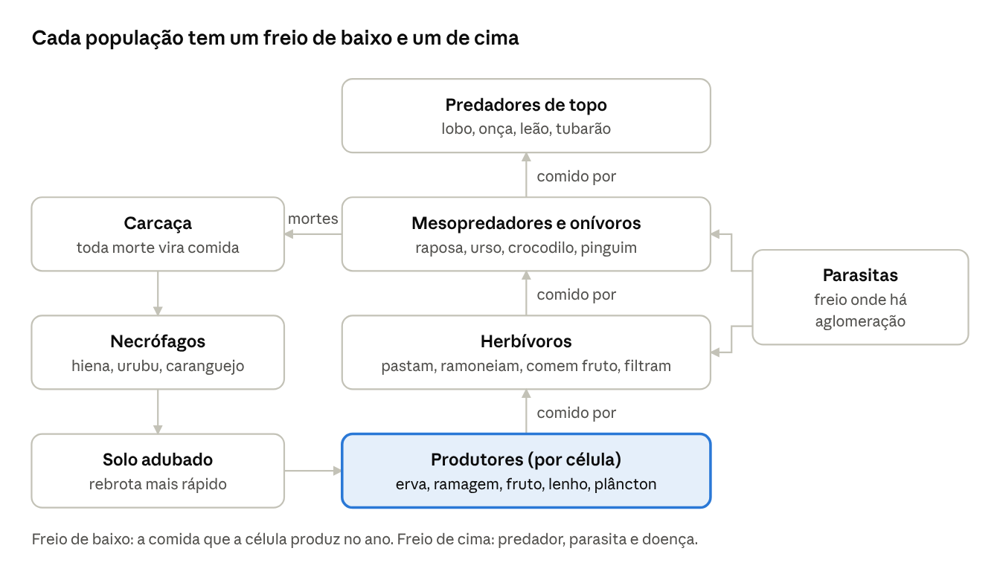

# Refatoração do Ecossistema — Estudo de Game Design

Estudo de game design · 28/10/2026 · versão editável: [Claude Doc](https://claude.ai/artifact/2KgZLHyWuzKgfQG2v5nwrY)

## Resumo e diagnóstico

A proposta troca o ecossistema atual, que é regulado por tetos globais e taxas por segundo, por um ecossistema regulado por **produtividade local**: cada região produz uma quantidade de comida por ano, e é isso que define quantos indivíduos (físicos, clicáveis) cabem ali. Os quatro problemas têm causas concretas no código, e três delas vêm da mesma raiz: a biologia está medida em segundos, não em anos.

**Como medi:** rodei a Terra no tamanho do jogo (1024×512, semente 42) por 40 anos com `yearSpan = 12`, que é o ano da tela na velocidade 1x (`REAL_YEAR_SECONDS` em `SurfaceMode.ts`). O script foi descartável e não entra no PR.

| Problema | Causa no código | Evidência medida |
| --- | --- | --- |
| 1. Mobilidade vs. tempo | Velocidade em tiles por segundo (`Species.speed`), ano de 12 s, e passeio aleatório: a cada 0,4 s o bicho sorteia uma direção nova (40% aleatória) e 15% das vezes para. Passeio aleatório cobre distância proporcional à raiz do tempo, não ao tempo. | Um cervo percorre ~11,7 tiles de caminho por ano, mas se desloca só **5,1 tiles** em linha reta. O mapa tem 1024 tiles de largura. |
| 2. Superpopulação | Teto **global** por espécie (`habitatCap`, até 1.600 herbívoros por espécie) e trava local só na hora do parto (`crowd`). Metabolismo e natalidade são por segundo (`birthRate` 0,14/s), mas a calibração usa ano de 6 s (`YEAR_SECONDS`) e a tela usa 12 s: na tela cada bicho vive o dobro de segundos, tem o dobro de chances de parto por vida e come o dobro por ano. | ~3.900 animais selvagens no ano 40, quase todas as espécies terrestres coladas no teto (Cervo 373, Coelho 368, Camelo 376, Tartaruga 391). |
| 3. Desmatamento | O herbívoro morde a vegetação **a cada decisão**, com ou sem fome (`decide`, caso `herbivore`): a energia passa de 1 e o excesso se perde. A vegetação é um número só por tile (`map.vegetation`), então comer capim numa floresta é o mesmo que derrubar a floresta. | Tiles de mata fechada caíram de 90,5 mil para 74,9 mil (−17%) em 40 anos. Parte é corte humano, mas a média de vegetação caiu no mapa inteiro, inclusive longe dos povos. |
| 4. Fome ilógica | (a) O bicho só come o tile em que está; (b) procura pasto com 10 sorteios aleatórios e, em seguida, `wander` mistura 40% de direção aleatória; (c) fugir do frio e fugir de qualquer predador (mesmo saciado) têm prioridade sobre comer; (d) frio e calor drenam energia e a morte é registrada como **fome**; (e) predadores não enxergam presas de espécie abaixo de 15% do teto. | Dos ~4.300 herbívoros mortos de fome, **~3.600 (84%) morreram com pelo menos 5 tiles de pasto verde a até 8 tiles**. 118 lobos morreram de fome em tiles com vegetação, e 290 mortes "de fome" foram na verdade frio ou calor. |

O que já funciona e deve ser preservado: o grid espacial (`forEachNear`), os fluxos de sorteio separados por subsistema, a variável `climate` por região (anos de seca e de fartura), a matriz de Whittaker em `biomes.ts` e o crescimento de árvores por tocos e mudas (`growForests`). A proposta reaproveita tudo isso.

## Mecânicas básicas: os quatro problemas

### 1. Mobilidade vs. tempo: dois relógios e uma agenda anual

A solução é separar **o que acontece por ano** (biologia) do **que acontece por segundo** (animação e ação), e ligar os dois por uma agenda anual de atividades. Assim o ano pode durar 6 s, 12 s ou 60 s e o bicho faz a mesma coisa por ano.

- **Relógio biológico (anos).** Idade, gestação, ração anual, ninhadas por ano, rebrota da vegetação e parasitas. Toda constante biológica passa a ser escrita "por ano" no catálogo e convertida com `dt / yearSpan`, como a idade já é hoje. Regra do projeto: nenhuma taxa biológica por segundo.
- **Relógio de ação (segundos).** Passos, mordidas, ataques, animação das pernas. Durações fixas em segundos, só para ficar bonito e legível.
- **A ponte: agenda anual.** Cada espécie tem um orçamento de atividades por ano. Exemplo de herbívoro: 8 a 12 refeições, 1 época de reprodução na primavera, 0 ou 1 migração sazonal. Com o ano de 12 s e uma decisão a cada 0,4 s, o bicho tem ~30 decisões por ano; 10 refeições de ~1 s (ir + comer) cabem com folga. Se o ano encurtar, as durações das ações encolhem na mesma proporção (`min(1, yearSpan / anoDeReferência)`); a quantidade de refeições por ano não muda.
- **Velocidade em área de vida por ano.** Em vez de "tiles por segundo", cada espécie tem uma **área de vida** (raio em tiles) e quantas vezes a atravessa por ano. A velocidade em tela sai daí e é limitada por um teto visual; acima do teto o sprite troca para o trote ou galope.

```latex
v_{tela} = \min\left(v_{max},\ \max\left(v_{min},\ \frac{2 R_{vida} \cdot travessias_{ano}}{yearSpan}\right)\right)
```

- Exemplo: cervo com área de vida de raio 10 e 3 travessias por ano anda 60 tiles por ano, ou 5 tiles/s no ano de 12 s. Hoje ele anda 5 tiles por ano em linha reta.
- **Andar com destino, não passear.** Toda atividade da agenda tem um alvo (mancha de pasto, parceiro, água, abrigo). O bicho anda reto até o alvo com um ruído pequeno de direção (o *wander* de Reynolds), e só sorteia direção quando está descansando. Isso muda o alcance de "raiz do tempo" para "proporcional ao tempo".
- **Migração como viagem.** Para ir longe (inverno, seca), o bicho traça a rota na grade de células ecológicas (seção 2) e anda na velocidade de viagem. Continua físico e clicável durante todo o caminho.
- **Nível de detalhe por câmera.** Na tela, decisão a cada 0,4 s; fora da tela, a cada 1,5 s com passos maiores. Como a agenda é por ano, o resultado anual é o mesmo, e a CPU sobra para mais espécies.
- **Portão de qualidade:** um teste roda a mesma semente com `yearSpan` 6 e 12 por 50 anos e exige populações a ±10% uma da outra. Hoje esse teste falharia, porque a tela (12 s) e a calibração (6 s) vivem em mundos diferentes.

### 2. Superpopulação: capacidade de suporte local

O teto global por espécie sai, e entra a **capacidade de suporte de cada célula ecológica** (16×16 tiles, 2.048 células na Terra), recalculada uma vez por estação. Um lugar sustenta quem ele consegue alimentar, e ninguém é apagado por um número invisível.

```latex
K_{s,c} = \frac{adequa\c{c}\tilde{a}o_{s,c} \times produ\c{c}\tilde{a}o_{c} \times parcela_{guilda}}{ra\c{c}\tilde{a}o\ anual_{s}}
```

- **Tamanho do corpo define a densidade.** Na natureza, a densidade cai com a massa na potência −0,75 (regra de Damuth). No jogo isso vira: uma célula boa tem ~12 coelhos, ~4 cervos, ~1 bisão e um elefante a cada 6 células. O mapa fica legível sem esconder ninguém.
- **Orçamento de entidades.** Para a Terra (1024×512) proponho ~2.500 animais terrestres e ~1.200 aquáticos, divididos pela pirâmide trófica: ~85% herbívoros e onívoros pequenos, ~12% predadores médios, ~3% predadores de topo. Hoje são ~3.900 selvagens com quase todas as espécies no teto. O orçamento escala com a área do planeta.
- **Natalidade pela densidade local** (Beverton–Holt): nascimentos por fêmea adulta por ano caem com a lotação da célula, e o parto acontece na estação própria. Substitui a curva global `fertility()`.
- **Dispersão natal.** Ao amadurecer, o jovem olha as células vizinhas (até 3) e vai para a de menor lotação (N/K). É o que espalha cervos e lobos na natureza e é o que desfaz os aglomerados.
- **Grupos com tamanho máximo e fissão.** Cada indivíduo guarda o id do seu bando. Quando o bando passa do tamanho típico da espécie (cervo 4–10, bisão 15–30, lobo 4–8), ele se divide e a metade nova anda até a célula vizinha mais vazia.
- **Território de predador.** Cada matilha ou predador solitário é dono de algumas células. Sem território não há reprodução, só dispersão. Isso limita os predadores de forma natural, como os lobos reais.
- **Piso contra extinção, sem truque invisível:**
  1. **Refúgios:** mata fechada, pedra e mangue reduzem a chance de captura, mais para bichos pequenos.
  2. **Troca de presa** (resposta funcional tipo III de Holling): o predador prefere a presa mais abundante da sua dieta; a rara sofre menos ataques, mas continua visível. Substitui a regra atual em que presas abaixo de 15% do teto ficam invisíveis e o predador morre de fome ao lado delas.
  3. **Recuperação local:** o bônus de natalidade da espécie rara continua, mas medido na célula.
  4. **Recolonização física:** se uma célula com habitat bom ficou vazia, a célula vizinha mais cheia daquela espécie ganha um empurrão de dispersão para lá. Os bichos andam até lá; nada aparece do nada.
  5. **Alerta na crônica** quando uma espécie cai abaixo da população mínima viável no planeta, para o jogador poder proteger.

### 3. Consumo em harmonia com a regeneração

O consumo só fica em equilíbrio quando a vegetação deixa de ser um número só. Proponho três camadas por tile, cada uma com seu ritmo e seu consumidor.

| Camada | O que é | Rebrota (de 10% até o teto) | Quem consome |
| --- | --- | --- | --- |
| Erva (`herb`) | capim, ervas, musgo, líquen | ~1 estação | pastadores (bisão, coelho, camelo) |
| Ramagem e fruto (`browse`) | folhas baixas, arbustos, frutos | 1–2 anos | ramoneadores e frugívoros (cervo, macaco, urso) |
| Lenho (`wood`) | cobertura de árvores | décadas (`growForests`) | só povos, fogo, pragas e engenheiros (elefante, castor) |

- **Rebrota logística por ano**, com chuva de sementes dos vizinhos. A colheita máxima sustentável acontece com a vegetação na metade do teto e vale rK/4 por ano; a capacidade de suporte da seção anterior usa só metade disso, para sobrar margem para anos de seca.

```latex
\frac{dV}{dt} = r\,V\left(1 - \frac{V}{K}\right) + s_{vizinhos} - consumo
```

- **Saciedade.** O bicho só come com energia abaixo de 0,7 e para em 0,95. Hoje ele morde a cada 0,4 s mesmo cheio.
- **Reserva de raiz.** O pastejo nunca leva a erva abaixo de 25% do teto do tile; o resto é raiz e volta sozinho.
- **Saber a hora de sair** (teorema do valor marginal, de Charnov): quando o ganho na mancha cai abaixo da média da área de vida, o bando muda de mancha. Na prática isso faz rodízio de pasto e impede o bando de raspar uma região até o chão.
- **Floresta só cai por quem derruba árvore.** Comer folhas numa floresta tira `browse`, não `wood`. O bioma florestal passa a depender de `wood`.
- **Referência Eco:** como no Eco, o impacto é medido e mostrado. Uma camada de mapa "pressão de pastejo" (consumo / produção por célula) e uma linha na crônica quando uma região passa de 100% por dois anos seguidos.

### 4. Fome lógica: prioridades explícitas e comida garantida

A regra de design é: **nenhum animal morre de fome se havia comida da sua dieta ao seu alcance**. Isso vira uma métrica de teste ("fome evitável" ≈ 0), medida como fiz no diagnóstico.

- **Árvore de prioridades** (no estilo da ThinkTree do RimWorld), avaliada a cada decisão, do topo para baixo:
  1. Perigo real: um predador caçando *este* bicho, ou com fome e a poucos tiles. Foge para o refúgio mais perto. Predador saciado não assusta.
  2. Fome crítica (energia < 0,3): comida acima de tudo, inclusive de conforto térmico leve e parceiro.
  3. Estresse térmico forte: vai para o abrigo ou para a faixa da espécie.
  4. Fome (energia < 0,7): comer.
  5. Reprodução, só na estação.
  6. Ficar com o bando, descansar, explorar.
- **Escolha de comida determinística e com compromisso.** O bicho consulta o mapa de comida da célula e das vizinhas, escolhe a melhor mancha por `comida − custo da distância`, e segue até lá sem sorteio no caminho. Guarda na memória a última mancha boa (um inteiro por indivíduo).
- **Predador com fome, não predador sempre.** Caça só abaixo de 0,6 de energia. A presa abatida vira **carcaça** com carne proporcional à massa: o lobo come até saciar e volta a ela nos dias seguintes, como no RimWorld; o que sobra alimenta necrófagos (hiena, raposa, urubu) e depois aduba o tile. Um cervo alimenta uma matilha por várias refeições, então são precisas menos mortes por ano.
- **Escolha da presa** (RimWorld: "quase qualquer animal menor que ele"): dieta da espécie, massa até o limite do predador (maior em matilha), pontuação por `carne / (distância + risco)`. Presa ferida, velha ou filhote pesa mais, que é o que os predadores reais fazem.
- **Causas de morte separadas:** fome, frio, calor, predação, doença ou parasita, velhice. Frio e calor deixam de drenar a energia da comida e passam a tirar **saúde**. Hoje 290 mortes registradas como fome foram frio ou calor, o que esconde o problema real na ficha do bicho.

## Integração de biomas: nicho por bioma, altura e temperatura

Cada espécie (da Terra ou alienígena) passa a ter um **nicho** descrito pelas variáveis que o motor já calcula por tile: `temperatureAt` (que já soma latitude, altitude e frentes), `elevation`, `moisture` e o `biome` da matriz de Whittaker. A adequação de um tile para a espécie é o produto de curvas suaves, e ela alimenta a capacidade de suporte da seção anterior. Hoje a espécie só tem uma faixa dura de temperatura (`tempMin`/`tempMax`).

```latex
adequa\c{c}\tilde{a}o_s(tile) = f_T(T) \cdot f_H(umidade) \cdot f_A(altitude) \cdot afinidade_s(bioma)
```

- `f_T`, `f_H`, `f_A`: curvas em sino (ou trapézio) com ótimo e tolerância por espécie. Fora da tolerância a adequação é zero e o bicho não fica ali; na borda ele aguenta, mas gasta mais ração.
- `afinidade(bioma)`: 0 a 1 por bioma, para capturar o que o clima sozinho não diz (o cervo precisa de mata para se esconder, o bisão de campo aberto).
- Tudo é pré-calculado por célula ecológica e recalculado só quando o jogador terraforma ou a estação muda.

### A flora sai do clima

A vegetação deixa de ser genérica e vira uma mistura de **tipos funcionais de planta** (o conceito que os modelos de vegetação global usam). Cada bioma tem a sua mistura, e cada tipo alimenta uma das três camadas.

| Bioma (já existe) | Tipos de planta | Erva | Ramagem e fruto | Lenho | Guildas que favorece |
| --- | --- | --- | --- | --- | --- |
| Planície | gramíneas, ervas floridas | alta | baixa | quase nula | pastadores em rebanho, roedores, predador de corrida |
| Savana | gramíneas C4, acácias | alta (seca no verão) | média | baixa | megafauna, pastadores migratórios, felinos, necrófagos |
| Floresta temperada | carvalho, arbustos de baga | média | alta | alta | ramoneadores, onívoros, lobo, urso |
| Taiga | coníferas, musgo | baixa | média | alta | alce, lebre, lince, lobo |
| Floresta tropical | árvores sempre-verdes, frutíferas | baixa | muito alta | muito alta | frugívoros (macaco), onça, cobras |
| Tundra | líquen, musgo, arbusto anão | baixa | baixa | nula | rena migratória, lebre-ártica, raposa-do-ártico |
| Deserto | cactos, arbustos secos | muito baixa | baixa | nula | camelo, roedores, cobra, poucos predadores |
| Pântano e manguezal | junco, mangue | média | média | alta | anfíbios, crocodilo, aves aquáticas, mosquito |
| Rocha e montanha | capim de altitude | baixa | baixa | nula | cabra-montesa, águia, puma |
| Mar e costa | fitoplâncton, algas, kelp | (campo de plâncton) | (algas na costa) | nula | peixes, filtradores, anfíbios de costa |

### Altura: andares de vida

O motor já esfria 30 K por unidade de elevação, então a montanha naturalmente repete os biomas em faixas (zonação altitudinal): floresta embaixo, campo de altitude, rocha e neve. A proposta usa isso para criar **migração vertical**: no verão cabras e cervos sobem para o pasto alto, no inverno descem. É um movimento curto, visível e fácil de entender, e já conversa com a transumância dos rebanhos dos povos (RF-VIDA-293).

- Altura também custa: subir encosta gasta mais ração, e o `MAX_CLIMB` já existente vira uma tolerância por espécie (cabra escala, bisão não).
- Picos acima de 0,72 de elevação têm produção zero: só servem de passagem e refúgio.

### Temperatura: metabolismo e estações

- **Custo térmico.** Longe do ótimo, a ração anual sobe (o bicho gasta para se aquecer ou resfriar). Com isso a capacidade de suporte cai sozinha nos extremos, sem regra especial.
- **Regras de Bergmann e Allen** na geração de variantes (`makeVariant` já faz "das-neves", "do-deserto"): no frio, corpo maior e orelhas e patas curtas; no calor, corpo menor e extremidades longas.
- **Estações.** O ano já tem estações para a colheita (`seasonOf`). A natureza passa a usar o mesmo relógio: a erva para de crescer no inverno nas latitudes altas, os partos acontecem na primavera e as migrações seguem a erva verde. O clima por região (`climate`, anos de seca ou fartura) multiplica a produção, então uma seca reduz a capacidade de suporte e o ecossistema responde com menos nascimentos e mais dispersão, antes de chegar à fome.

## Seleção de espécies terráqueas

A recomendação é organizar a Terra por **guildas** (função no ecossistema), com 1 a 2 espécies por guilda em cada bioma, em vez de somar espécies soltas. As 14 nativas atuais ficam (3 mudam de papel), 7 passam do banco para nativas e entram 4 novas para fechar buracos da cadeia (pastador do frio, pastador de montanha, predador da savana, necrófago aéreo). Insetos e decompositores entram como campos, na seção 5. O banco genético de 30 continua, mas animais domésticos (ovelha, galinha, lhama) deixam de ser selvagens e ficam só nos rebanhos dos povos.

**Erros de papel no catálogo atual** (em `species.ts`), que valem corrigir com ou sem a refatoração:

- **Baleia** está como `shark`: caça peixe e ataca barco. Deveria ser filtradora de plâncton e krill, mansa.
- **Pinguim** está como herbívoro que come alga. Deveria comer peixe (e ser presa de foca ou orca, se entrarem).
- **Sapo** está como herbívoro. Deveria comer insetos (o campo de insetos da seção 5).
- **Caranguejo** está como herbívoro. Deveria ser detritívoro e necrófago da costa, limpando carcaças.

### Fauna proposta para a Terra

| Espécie | Decisão | Guilda | Onde vive | Utilidade no jogo | Ciclo (maturidade · crias/ano · vida) |
| --- | --- | --- | --- | --- | --- |
| Coelho | manter | pastador pequeno | planície, borda de mata | comida-base de raposa e lobo; responde rápido a anos bons e ruins | 1 ano · 2 ninhadas de 3–4 · 6 anos |
| Cervo | manter | ramoneador | floresta temperada, taiga | presa principal do lobo; abre trilhas; caça dos povos | 2 · 1 · 12 |
| Bisão | manter | pastador de rebanho | planície, savana fria | rebanho grande e migratório; mantém o campo aberto | 3 · 1 · 18 |
| Camelo | manter | pastador do seco | deserto, savana seca | único grande herbívoro do deserto; base para a caravana | 4 · 0,5 · 20 |
| Elefante | mover do banco para nativo | megafauna engenheira | savana, floresta tropical | derruba algumas árvores e abre clareiras (aumenta erva e diversidade) | 8 · 0,25 · 40 |
| Rena | **nova** (substitui o mamute nativo) | pastador migratório do frio | tundra, taiga | migração sazonal visível; presa do lobo no frio | 2 · 1 · 15 |
| Cabra-montesa | **nova** (variante selvagem da Cabra) | pastador de altitude | rocha, montanha | ocupa os andares altos; migração vertical | 2 · 1 · 14 |
| Macaco | mover para nativo | frugívoro | floresta tropical | come fruto e espalha sementes (acelera a rebrota da mata) | 3 · 0,5 · 25 |
| Javali | mover para nativo | onívoro de solo | floresta, pântano | revolve o solo (fertilidade), presa média | 1,5 · 1 ninhada de 4 · 10 |
| Raposa | manter | mesopredador onívoro | quase todos | controla coelho e roedor; come carcaça e fruto | 1 · 1 ninhada de 3 · 8 |
| Lobo | manter | predador de topo em matilha | floresta, taiga, tundra | regula cervo e rena; território visível | 2 · 1 ninhada de 3 (só o casal alfa) · 14 |
| Urso | manter | onívoro grande | floresta, taiga | come fruto, peixe no rio e carcaça; hiberna (some menos comida no inverno) | 4 · 0,5 · 22 |
| Onça | mover para nativo | predador de emboscada | floresta tropical, pântano | topo da selva; usa a mata como refúgio de caça | 3 · 0,5 · 14 |
| Leão | **novo** | predador em grupo | savana | topo da savana; caça megafauna jovem em grupo | 3 · 0,5 · 14 |
| Hiena | mover para nativo | necrófago e caçador | savana | limpa carcaças dos leões; fecha o ciclo da carne | 2 · 0,5 · 12 |
| Urubu | **novo** (ave) | necrófago aéreo | todos os biomas abertos | sinaliza carcaças no mapa (leitura fácil para o jogador) | 3 · 0,5 · 15 |
| Crocodilo | mover para nativo | predador anfíbio | rio, pântano, mangue | caça quem vai beber água; fronteira terra-água | 6 · 1 ninhada de 6 · 40 |
| Sapo | manter, virar insectívoro | insectívoro | pântano, beira de rio | consome o campo de insetos (controla mosquito e praga) | 1 · 1 desova grande · 5 |
| Tartaruga | manter | herbívoro de costa | costa, rio | vida longa; resiliente | 8 · 1 ninhada · 60 |
| Caranguejo | manter, virar detritívoro | decompositor de costa | praia, mangue | limpa carcaças e restos na costa | 1 · 1 desova · 6 |
| Pinguim | manter, virar piscívoro | caçador de peixe no frio | costa polar | liga o mar frio à terra | 3 · 1 · 18 |

**Aquáticos:** Peixe (cardume, forrageiro), Lula e Piranha (piscívoros médios), Tubarão (topo, ataca barcos), Baleia (filtradora, mansa, vida longa), Tartaruga-marinha (come alga e água-viva). O plâncton continua como **campo** por célula, não como indivíduos, igual à vegetação: é produtor, não animal.

**Ficam só no banco genético:** Mamute (era do gelo, para o jogador soltar), Cobra (sobra; volta quando houver roedores), Lhama, Ovelha e Galinha (domésticas).

### Flora proposta para a Terra

A flora não precisa de indivíduos andando, mas precisa ter **nome e ciclo visíveis** na ficha do tile, para o jogador entender o que o bicho está comendo.

| Planta | Tipo | Camada | Bioma | Ciclo e papel |
| --- | --- | --- | --- | --- |
| Capim | gramínea | erva | planície, savana | rebrota em uma estação; aguenta pastejo pesado |
| Flores do campo | erva florida | erva | planície, floresta | alimenta polinizadores; sobe a fertilidade |
| Arbusto de baga | arbusto | ramagem e fruto | floresta, borda de mata | frutifica no verão (comida de urso, raposa, povos, RF-VIDA-390) |
| Carvalho | árvore decídua | lenho | floresta temperada | 30–50 anos para fechar; dá madeira e abrigo |
| Pinheiro | conífera | lenho | taiga, montanha | cresce no frio; dá madeira |
| Árvore frutífera tropical | sempre-verde | lenho + fruto | floresta tropical | frutifica o ano todo (comida do macaco) |
| Acácia | árvore de savana | lenho + ramagem | savana | esparsa; comida do elefante |
| Cacto | suculenta | ramagem | deserto | guarda água; comida do camelo |
| Líquen e musgo | não vascular | erva | tundra | crescimento lentíssimo; comida da rena (pastejo lento) |
| Junco e mangue | aquática | erva + lenho | pântano, manguezal | berçário de peixes; protege a costa |
| Kelp e fitoplâncton | alga | campo do mar | costa, oceano | base de toda a cadeia marinha |

## Geração de espécies alienígenas

O princípio é a **convergência funcional**: planetas diferentes produzem formas diferentes, mas os mesmos papéis (pastador, ramoneador, caçador de emboscada, necrófago, filtrador). O gerador preenche esses papéis com corpos ditados pelo clima. Assim o motor tem um código só: as espécies da Terra viram instâncias escritas à mão do mesmo molde que o gerador usa para os alienígenas. Hoje `nativeSpecies` gera só nome e cor aleatórios sobre cinco moldes fixos.

### O molde comum

Cada espécie, terráquea ou não, é descrita pelos mesmos campos, todos por ano:

- **Nicho:** ótimo e tolerância de temperatura, umidade e altitude; afinidade por bioma; terra, água ou costa.
- **Dieta:** lista de etiquetas (`erva`, `ramagem`, `fruto`, `carne:<faixa de massa>`, `carcaça`, `plâncton`, `insetos`), com preferência.
- **Corpo:** massa (define densidade, ração anual e quem pode caçá-lo), forma, locomoção, defesa.
- **Ciclo:** maturidade, época e tamanho da ninhada, vida máxima.
- **Social:** solitário, casal, bando (tamanho típico), territorial ou não.
- **Movimento:** raio da área de vida, travessias por ano, migratório ou não.

### O gerador, passo a passo

1. **Ler o planeta.** Histograma de (temperatura, umidade, altitude) das células de terra, fração de água, gravidade (pelo `radiusEarth`), tipo da estrela e o potencial de vida (`planet.life`).
2. **Calcular a produção primária** de cada célula (luz × calor × água × vida). Da produção total sai **quantos níveis tróficos** o planeta aguenta: só cerca de 10% da energia passa de um nível para o de cima (Lindeman), então planeta pobre tem só plantas, médio tem plantas e herbívoros, rico chega a predadores de topo. Isso substitui os sorteios fixos de 25% e 8% por uma consequência do clima (o sorteio pode continuar como chance de a vida ter surgido).
3. **Gerar a flora.** Agrupar os climas presentes em 3 a 7 grupos e criar um tipo de planta para cada um, com forma (tapete, tufo, haste, coluna, flutuante, crosta), camada (erva, ramagem, lenho), ritmo de crescimento e defesa (espinho ou toxina, que reduz quem come e cria especialistas). A cor sai da estrela: sob anãs vermelhas a hipótese de Kiang (2007) sugere folhas escuras, quase pretas, para captar toda a luz; sob estrelas mais quentes que o Sol, tons amarelos, laranja ou azulados.
4. **Abrir vagas de consumidores.** Para cada camada com produção suficiente, uma vaga de herbívoro (pastador, ramoneador, frugívoro; no mar, filtrador). Para cada faixa de tamanho de presa, uma vaga de predador, se o nível trófico existir. Sempre que houver animais, uma vaga de necrófago e uma de decompositor.
5. **Dar corpo pelo ambiente** (regras fáceis de ler na ficha):
   - Gravidade alta: corpo baixo, pernas grossas ou mais patas, tamanho máximo menor. Gravidade baixa: corpos altos, saltadores e planadores.
   - Frio: corpo maior, extremidades curtas, pelagem ou carapaça (Bergmann e Allen). Calor: corpo menor, extremidades longas, hábito noturno.
   - Seco: couro grosso, reserva de água (o "camelo" local). Muita água: anfíbios e vida de costa.
   - Relevo alto: garras e escaladores. Planeta de ilhas: mais espécies endêmicas e menores (nanismo insular).
   - O corpo escolhe as partes do sprite (`ALIEN_BODIES` e `art-extra.ts`), então o visual conta a história do clima.
6. **Nomear** com as sílabas atuais (`alienName`) mais um descritor da guilda ("pastador-de-crosta", "caçador-das-pedras"), para a ficha dizer o papel.
7. **Validar antes de existir.** Rodar 100 anos do ecossistema só com números por célula (as mesmas equações da seção 1, sem indivíduos), o que custa milissegundos. Se uma espécie some ou explode, ajustar ninhada e ração e repetir. Só então criar os indivíduos físicos, já na densidade de equilíbrio de cada célula. Tudo determinístico pela semente do planeta.

### Regras de segurança da teia

- Todo predador tem pelo menos 2 presas possíveis, ou é onívoro.
- Toda presa tem pelo menos um controle (predador, parasita ou doença): nenhuma espécie cresce sem freio.
- A presa pesa entre 10% e 150% do predador (mais em matilha).
- Espécies introduzidas usam as mesmas etiquetas de dieta. Uma planta alienígena com toxina é intragável para bichos da Terra, e um bicho terráqueo sem predador local pode virar **espécie invasora** (como o sapo-cururu na Austrália). É uma consequência sistêmica interessante para a terraformação, sem regra especial.

## Dinâmica do ecossistema

O sistema roda sozinho quando cada população é segurada por **dois freios ao mesmo tempo**: um de baixo (comida) e um de cima (predador, parasita ou doença). Com um freio só, aparecem as explosões e os colapsos de hoje. Abaixo estão os sete ciclos que formam a teia, todos com indivíduos físicos e nenhum efeito invisível.



A energia sobe pela coluna do meio; toda morte volta ao solo pela coluna da esquerda; parasitas apertam onde há aglomeração.

### Os sete ciclos

1. **Planta e herbívoro.** Rebrota logística, saciedade, reserva de raiz e saída da mancha pelo valor marginal (seção 1). Freio de baixo para os herbívoros.
2. **Herbívoro e predador.** Caça só com fome, troca de presa (tipo III), refúgios e território. O resultado são oscilações amortecidas: o "boom e bust" que o Eco mostra, mas sem chegar a zero, porque refúgio e território cortam os extremos.
3. **Paisagem do medo.** Herbívoros evitam células onde predadores caçaram recentemente (uma memória por célula que decai em uma estação). O pastejo cai ali e a mata se recupera, que é a cascata trófica observada depois da volta dos lobos a Yellowstone. No jogo, o jogador vê o efeito de soltar um predador no mapa da vegetação.
4. **Parasitismo, dependente da densidade.** Cada indivíduo tem uma **carga parasitária** (0 a 1), visível na ficha. A chance de pegar cresce com a lotação da célula e com pasto e água compartilhados; a carga reduz a fertilidade e a velocidade, deixando o bicho mais fácil de caçar. É o freio que aparece justamente onde há aglomeração, que é o problema 2. Parasitas propostos para a Terra: carrapato (mamíferos grandes), verme intestinal (pastadores), sarna (canídeos), malária pelo campo de mosquitos do pântano (também afeta os povos e conversa com `epidemics()`).
5. **Morte e reciclagem.** Morte vira carcaça física no mapa, que alimenta o predador que matou, depois necrófagos (hiena, urubu, raposa, caranguejo), depois aduba o tile (RF-VIDA-24) e acelera a rebrota. A carcaça também é leitura visual: urubus circulando mostram onde houve caça.
6. **Insetos como campo.** Insetos não são indivíduos: são um valor por célula, como o plâncton. Polinizadores aumentam o fruto; em anos quentes e úmidos o campo pode virar **praga** (gafanhoto) que come erva e lavoura (RF-VIDA-63); sapos e aves comem o campo e seguram a praga.
7. **Perturbação e sucessão.** Fogo em savana seca, seca regional (o `climate` já existente) e engenheiros como o elefante abrem clareiras. A clareira passa por erva, arbusto e mata ao longo de décadas. O mapa vira um mosaico de idades, e um mosaico sustenta mais espécies do que uma floresta uniforme (hipótese da perturbação intermediária, de Connell).

### Os povos dentro da teia

Povos usam as mesmas contas. A caça (que já poupa espécies abaixo de 25% do teto) passa a olhar a lotação da célula; rebanhos domésticos comem a mesma erva da célula e entram na pressão de pastejo; o corte de lenha entra na camada `wood`. Assim o jogador vê a civilização pressionando a natureza no mesmo mapa, que é exatamente o ciclo de impacto do Eco.

### Metas mensuráveis

Cada meta vira um indicador em `calibrate.ts`, rodado em várias sementes sem o jogador mexer.

| Indicador | Hoje (semente 42, 40 anos) | Meta |
| --- | --- | --- |
| Mortes de fome com comida a até 8 tiles | 84% das mortes de fome de herbívoros | menos de 2% |
| Mortes de frio ou calor registradas como fome | 290 | 0 (causa própria) |
| Animais selvagens na Terra | ~3.900, quase todos no teto | dentro do orçamento (~3.700), com N/K médio entre 0,5 e 0,9 |
| Maior bando | sem limite | até o tamanho típico da espécie |
| Mata fechada sem povos por perto | caindo | estável em ±5% em 100 anos |
| Extinções em 200 anos sem jogador | 1 (lobo, análise anterior) | 0 |
| Diferença de populações entre ano de 6 s e de 12 s | não medido (relógios diferentes) | até 10% |
| Deslocamento líquido de um cervo por ano | 5 tiles | 30–60 tiles |

## Roteiro de implementação

A ordem vai do mais barato e mais visível para o mais estrutural. Cada etapa é um PR para `development`, com o indicador da tabela anterior como portão para passar à seguinte. Nada disso foi implementado ainda: este documento é só o plano.

1. **Correções rápidas, sem mudar a arquitetura.** Saciedade (comer só com fome), fome crítica acima de conforto e parceiro, fugir só de predador que caça, causa de morte térmica separada, troca de presa no lugar das presas invisíveis, papéis corretos de baleia, pinguim, sapo e caranguejo. Portão: fome evitável abaixo de 20%.
2. **Relógio biológico e agenda anual.** Taxas por ano, velocidade por área de vida, andar com destino, nível de detalhe fora da tela. Portão: teste de invariância 6 s × 12 s e cervo andando 30+ tiles por ano.
3. **Camadas de vegetação.** `herb`, `browse` e `wood` no `SurfaceMap`, rebrota logística, reserva de raiz, saída pelo valor marginal, camada de mapa de pressão de pastejo. Portão: mata estável em ±5% longe dos povos.
4. **Células ecológicas e capacidade local.** Adequação por nicho, K por célula, densidade por massa, natalidade Beverton–Holt, dispersão natal, bandos com fissão, territórios; saem `habitatCap`, `MIN_CAP` e o `crowd` global. Portão: orçamento de entidades e maior bando dentro do limite.
5. **Ciclos de cima e de fora.** Carcaças e necrófagos, parasitas, insetos como campo, paisagem do medo, fogo e sucessão. Portão: zero extinções em 200 anos em 10 sementes.
6. **Molde comum, Terra nova e gerador alienígena.** Catálogo da seção 3 no molde, gerador da seção 4 com pré-simulação. Portão: 100 planetas gerados, todos estáveis por 200 anos.

Saves antigos: os arrays novos (camadas, bando, carga parasitária, memória de mancha) entram com valores padrão em `fixAfterLoad`, como já é feito com outros campos.

## Referências

Páginas abertas para este estudo:

- [RimWorld Wiki: Predator](https://rimworldwiki.com/wiki/Predator) e [Animals](https://rimworldwiki.com/wiki/Animals): predadores comem primeiro carcaças e comida fácil, só caçam com fome, aceitam "quase qualquer animal menor" e voltam à carcaça; animais comem até a saciedade.
- [RimWorld Wiki: parâmetros de bioma](https://rimworldwiki.com/wiki/Template:Infobox_biome): densidade de animais, densidade de plantas e dias de rebrota por bioma (base para a capacidade por célula).
- [Eco: How the Eco-Sim works](https://www.moddb.com/news/how-the-eco-sim-works-the-players-lifeline): simulação contínua de plantas e animais individuais, ciclos de boom e bust, e registro de populações e taxas para o jogador ver o impacto.
- [Damuth (1981), densidade e massa corporal](https://pdodds.w3.uvm.edu/files/papers/others/1981/damuth1981a.pdf): densidade cai com a massa na potência −0,75.
- [Kiang (2007), a cor das plantas em outros mundos](https://www.nature.com/news/2007/070409/full/news070409-7.html): pigmentos dependem do espectro da estrela.
- [Lehtinen et al., resposta funcional tipo III](https://jyx.jyu.fi/jyx/Record/jyx_123456789_92517): base da troca de presa que estabiliza predador e presa.

Conceitos clássicos citados de memória, sem página aberta: teorema do valor marginal (Charnov, 1976), regra dos 10% entre níveis tróficos (Lindeman, 1942), hipótese da perturbação intermediária (Connell, 1978), regras de Bergmann e Allen, cascata trófica dos lobos de Yellowstone e o modelo de Beverton–Holt.
